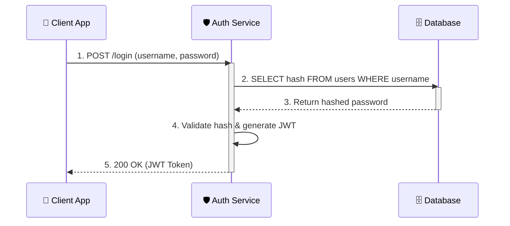
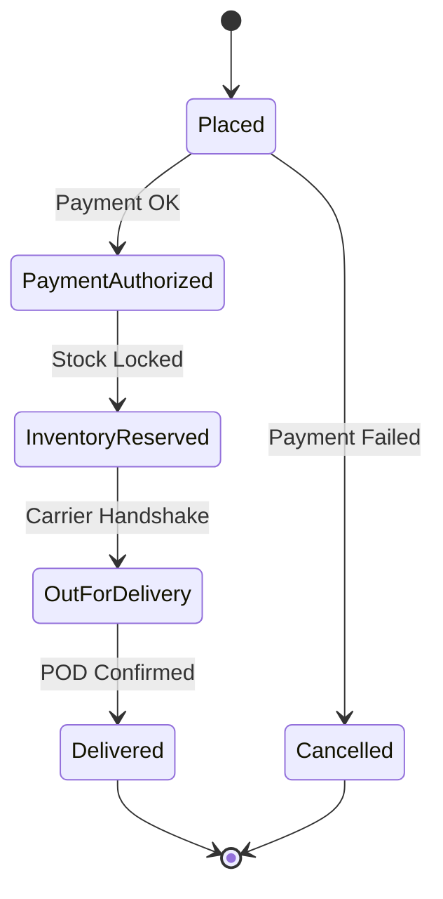

# Architecture Diagrams & Communication

  <strong>The Visual Language of Architecture:</strong> Senior engineers do not draw chaotic spaghetti diagrams. They use standardized visual abstraction tiers—primarily the C4 Model (Context & Containers) and Sequence Diagrams—to communicate distributed workflows, data flow directions, and fault-tolerance boundaries with crystal clarity.

> [!ANSWER30]
> In a 45-minute HLD interview, fly at C4 Level 1 (Context) for the first 5 minutes to align on boundaries, then zoom into C4 Level 2 (Containers: API Gateway, Microservices, Caches, DBs) for 70% of the session. Always layout whiteboards strictly Left-to-Right: Clients &rarr; Edge/CDN &rarr; API Gateway &rarr; App Services &rarr; Data Tier. Use Sequence Diagrams exclusively for multi-step protocols like OAuth, 2PC, or payment checkout.

<ul class="hsteps">
  <li>
    01
    <strong>Clients (Far Left)</strong>
    Mobile apps, desktop browsers, third-party API consumers, and IoT devices.
  </li>
  <li>
    02
    <strong>Edge & Ingress</strong>
    Anycast DNS, Edge CDN PoPs, TLS termination, API Gateways, and L4/L7 Load Balancers.
  </li>
  <li>
    03
    <strong>Application Tier</strong>
    Stateless microservices, async event brokers (Kafka/RabbitMQ), and batch workers.
  </li>
  <li>
    04
    <strong>Data Persistence (Far Right)</strong>
    In-memory caches (Redis), relational read-replicas, NoSQL clusters, and S3 object lakes.
  </li>
</ul>

## Overview

Welcome to the core visual language of System Design! You can have the most brilliant architecture in the world, but if you cannot draw it clearly on a whiteboard, you will fail the interview.

An interviewer uses your whiteboard (or digital drawing tool) to judge your seniority. Junior engineers draw chaotic spaghetti diagrams with crossing lines and ambiguous arrowheads. Senior engineers structure their drawings deliberately to tell a coherent architectural story.

In this masterclass, we will cover the industry-standard diagrams, what level of detail you should use, and exactly how to layout your whiteboard for maximum points.

---

## C4 model levels

When drawing diagrams, you need to know *what altitude* you are flying at. The **C4 Model** (Context, Containers, Components, Code) is the industry standard for visualizing software architecture across levels of abstraction.

In a 45-minute interview, you will almost exclusively operate at **Level 1** and **Level 2**.

| Level | Name | Description | Interview Use Case |
| :--- | :--- | :--- | :--- |
| **Level 1** | **System Context** | Shows the target system as a single central box interacting with human users and external third-party services. | The first 5 minutes to confirm scope and clarify external boundaries. |
| **Level 2** | **Containers** | Zooms into the system box. Shows major runtime containers: Web App, API Gateway, Microservices, Message Brokers, and Databases. | **The core "High-Level Design" (HLD).** You will spend 70% of your interview time here. |
| **Level 3** | **Components** | Zooms into a single container to display its internal controllers, services, repositories, and connection pools. | Used only if the interviewer specifically asks for a "Deep Dive" into an algorithm or sub-module. |
| **Level 4** | **Code / Classes** | UML classes, method signatures, and interface inheritance. | **Never draw this in HLD.** Reserved strictly for Object-Oriented Low-Level Design (LLD). |

> [!SCOPE]
> **C4 Altitude Rules in an Interview:**
> 1. **Never skip Level 1 Context:** Explicitly verify external boundaries before drawing services. Ask: *"Before I zoom into internal microservices, does this high-level context with external payment gateways and SMS providers capture our scope?"*
> 2. **Lock into Level 2 Containers:** Draw clear boundary lines between stateless application containers and stateful storage clusters.
> 3. **Resist descending into Level 4 Code:** If you find yourself writing class definitions or Java getters in a System Design interview, pull back immediately.

> [!TIP]
> **Teacher's Secret:** Never start drawing a Level 2 Container diagram until the interviewer explicitly agrees with your Level 1 Context diagram. "Before I break this down, does this high-level flow look correct to you?"

---

## UML class and sequence diagrams

### Sequence Diagrams
Sequence diagrams are incredibly powerful in System Design interviews. They do not show *where* components physically live; they show *when* events and network calls happen in chronological order.

Think of a Sequence Diagram like a film screenplay. It reads top-to-bottom and shows the exact protocol exchange between Client, Service, Auth, and Database:

**When to use sequence diagrams:** Use them whenever explaining **Authentication Handshakes (OAuth2 / OpenID Connect)**, **Distributed Transactions (Saga pattern / Two-Phase Commit)**, or **Payment Processing (Stripe webhooks with idempotency keys)** where event ordering and error compensation determine correctness.

### UML Class Diagrams
Class diagrams show the static structure of the code (Objects, Attributes, Methods, and Inheritance).

> [!WARNING]
> **Beginner Mistake:** Do not draw UML Class diagrams in a standard System Design (Distributed Systems) interview! They are meant for Object-Oriented Design (OOD) interviews (e.g., "Design a Parking Lot" or "Design a Chess Game"). If you start drawing UML classes when asked to "Design Twitter", you are answering the wrong interview question.

---

## Activity and state diagrams

### State Diagrams (State Machines)
A State Diagram illustrates all permissible states of a domain entity and the explicit events that trigger state transitions.

Think of an Uber Ride or an E-Commerce Order. It is never a vague "in progress" boolean flag:
- `Order Placed` &rarr; `Payment Authorized` &rarr; `Inventory Reserved` &rarr; `Fulfillment Packing` &rarr; `Out for Delivery` &rarr; `Delivered`.
- Exceptional transitions: `Payment Failed` &rarr; `Order Cancelled`; `Return Requested` &rarr; `Refund Issued`.

**When to use state machines:** If designing an order lifecycle (Amazon), ride matching (Uber), or job processing pipeline (Airflow), sketching a state machine proves you understand distributed failure edge cases, race conditions, and idempotent retries.

### Activity Diagrams
These are essentially advanced flowcharts with fork/join concurrency bars. In a 45-minute time crunch, activity diagrams take too long to construct. Prefer concise Sequence Diagrams for communication.

---

## Whiteboard layout strategy

The physical (or digital) layout of your whiteboard is just as important as the boxes you draw. If you run out of space and start drawing arrows backwards across your own diagram, the interviewer will get confused and you will lose points.

### The "Left-to-Right" Rule
Always draw data flowing strictly from **Left to Right**:
1. **Far Left:** The Clients (Mobile App, Web Browser, external sensors).
2. **Middle Left:** The Entry Points (Load Balancers, API Gateways, CDN).
3. **Middle Right:** The Application Logic (Microservices, Message Queues).
4. **Far Right:** The Data Layer (Databases, Caches, Object Storage).

> [!TRADEOFF]
> **Synchronous vs Asynchronous Communication Visuals:**
> - **Synchronous RPC (gRPC / HTTP):** Draw with a **solid line with filled arrow** (`──►`). Indicates the caller blocks waiting for a response (adds caller latency).
> - **Asynchronous Message (Kafka / SQS):** Draw with a **dashed line into a cylindrical or queue buffer** (`- - ► [Queue] - - ►`). Indicates fire-and-forget decoupling with eventual processing.
> - **Visual Benefit:** The interviewer can instantly diagnose whether your architecture has tight temporal coupling without asking.

### The "Top-to-Bottom" Rule (For Deep Dives)
Leave the bottom 30% of your whiteboard empty at the start of the interview. When the interviewer asks you to deep-dive into a specific bottleneck (e.g., "How does the Newsfeed ranking service work?"), use that bottom space to draw a zoomed-in Level 3 Component diagram. **Do not erase your main Level 2 HLD!**

> [!LEARN]
> **Senior Whiteboard Communication Rules:**
> 1. **Color Coding Discipline:** Use **Black/Dark** for standard component boxes, **Green** for the primary happy-path flow, and **Red** for error recovery, retries, and dead-letter queues.
> 2. **Explicit Data Arrows:** Always write short labels on arrows (`1. GET /feed`, `2. Check Redis`, `3. Fallback to DB`) instead of unlabeled directional lines.
> 3. **Never Erase High-Level Architecture:** When asked to deep dive, zoom in beneath or beside the primary flow so the overall context remains visible for the final interview recap.

> [!NOTE]
> **Pro-Tip:** If using an iPad or digital whiteboard (like Excalidraw), use clean component groupings with dashed bounding boxes for VPC or Region boundaries. This visual separation immediately conveys security and network zone boundaries to the interviewer.
